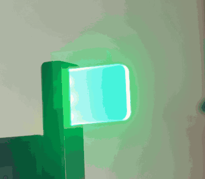
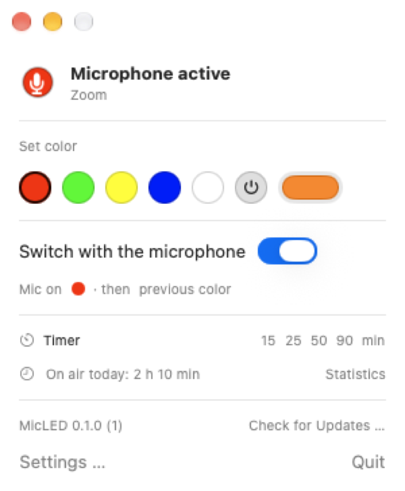
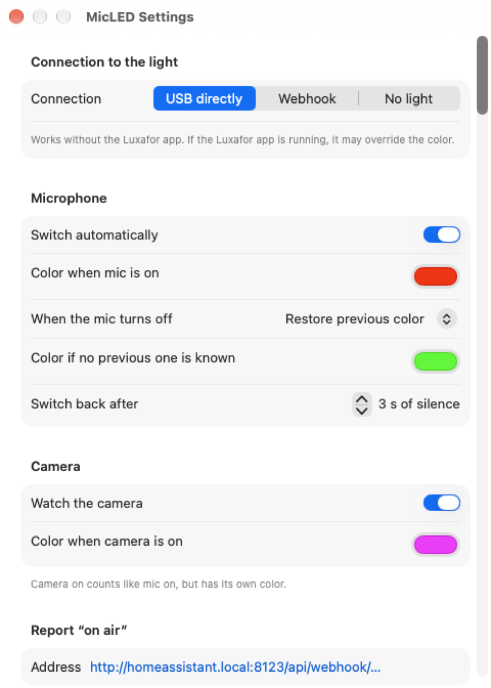
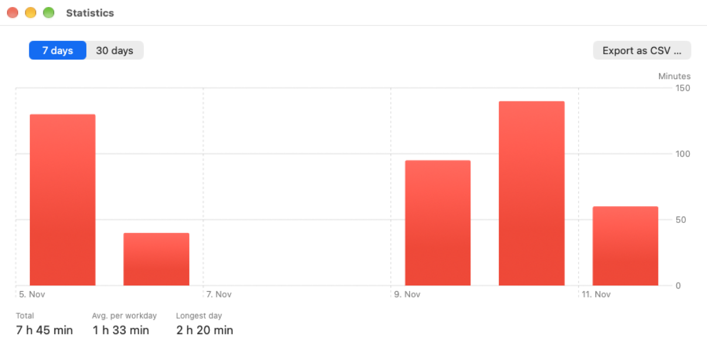
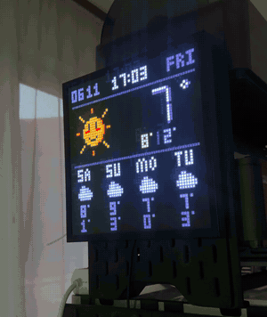
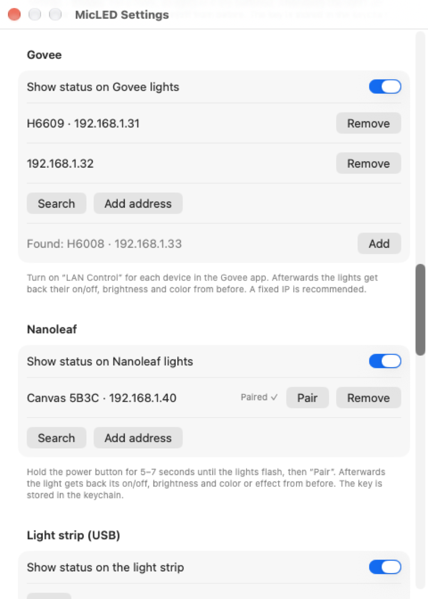
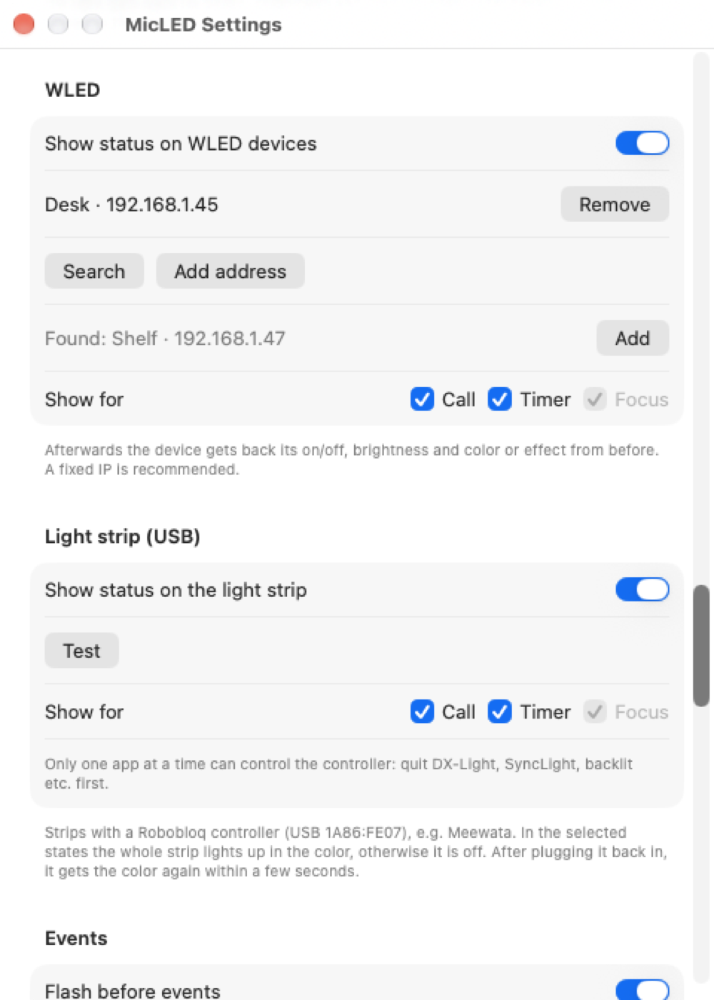
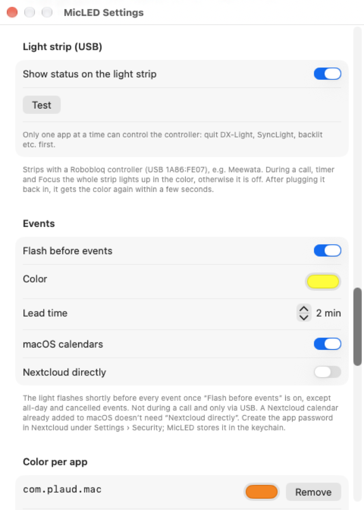

# MicLED

[](#requirements)
[](apps/MicLED)
[](crates/micled-core)
[](https://github.com/toolwerk/micled/actions/workflows/ci.yml)
[](LICENSE)

[Deutsch](README.md) · **English**

**Your Luxafor light shows when you are on air.** MicLED sits in the macOS menu bar and switches the light to red as soon as an app uses the microphone or the camera. Afterwards the previous color comes back.

You don't need a Luxafor for this: MicLED shows the status just as well with Philips Hue, Govee, Nanoleaf, WLED, a USB light strip or on a Pixoo or AWTRIX display, individually or together.

<p align="center">
  
  &nbsp;&nbsp;
  <picture>
    <source media="(prefers-color-scheme: dark)" srcset="docs/images/en/menu-dark.png">
    
  </picture>
</p>

## Features

- 🎙️ **Microphone and camera** are detected, whatever the app: Zoom, Teams, Meet in the browser, FaceTime or Plaud. No audio is read.
- 🎨 **Colors of your choice**: a custom color for microphone, camera and individual apps, then back to the previous color.
- ⏱️ **Timer** with its own color; at the end the light flashes.
- 🌙 **Focus and evening**: a custom color while a macOS Focus is on, dimmed in the evening.
- 📅 **Warning before events** from the macOS calendars or directly from Nextcloud.
- 💬 **Slack status** “In a call” while you are on air.
- 🖼️ **Pixoo 64**: “ON AIR” (during an event with its end, e.g. “TIL 14:30”), the remaining timer time or Focus on a Divoom display in your own network, even without any light.
- 🕒 **AWTRIX clock**: the same display on an Ulanzi pixel clock with AWTRIX 3, for example at the office door.
- 💡 **Philips Hue**: a Hue light or a whole room lights up in the status color and returns to its previous light afterwards.
- 🌈 **Govee, Nanoleaf and WLED**: lights and LED strips in your own Wi-Fi show the status color and get their light or effect back afterwards, without an account and without the cloud.
- 📺 **Light strip on the monitor**: a USB strip with a Robobloq controller (e.g. Meewata) lights up in the color during a call, timer and Focus.
- 🏠 **Home Assistant**: “on air” via webhook, e.g. for a door sign.
- 📊 **Statistics**: time on air per day, export as CSV.
- ⌨️ **Remote control** via `micled://` URLs, Shortcuts and the Stream Deck.
- 🔌 **USB directly** without the Luxafor app, or optionally via the Luxafor webhook.

## Screenshots

<table>
  <tr>
    <td width="50%">
      <picture>
        <source media="(prefers-color-scheme: dark)" srcset="docs/images/en/settings-dark.png">
        
      </picture>
    </td>
    <td width="50%">
      <picture>
        <source media="(prefers-color-scheme: dark)" srcset="docs/images/en/stats-dark.png">
        
      </picture>
    </td>
  </tr>
  <tr>
    <td align="center">Settings</td>
    <td align="center">Statistics</td>
  </tr>
</table>

<details>
<summary><b>All features in detail</b></summary>

- Detects every app currently reading from the microphone (Zoom, Teams, Meet in the browser, Plaud, FaceTime …) via CoreAudio. No audio is read, and no microphone permission is needed.
- Two configurable colors: “Color when mic is on” (default red) and “Color when mic is off” (default green).
- After the microphone, either back to the previous color or always to the “Color when mic is off”.
- Quick colors and a color picker in the menu for switching directly.
- Control via USB directly (without the Luxafor app) or via the Luxafor webhook.
- Apps can be ignored, for example a dictation tool that keeps the microphone open all the time. Known audio services such as `arkaudiod` by Rogue Amoeba are entered by default.
- During sleep, with the display off and when locked, the light turns off and comes back on with the previous color afterwards. During a call it stays in the mic color.
- Delay before switching back (default 3 seconds), so short pauses don't flicker.
- Camera detection via CoreMediaIO: camera on counts like mic on and has its own color (default magenta).
- Color per app, e.g. orange for a recording with Plaud and red for calls. With several apps, the top entry wins; the camera color takes precedence.
- Report “on air” to the outside: on every change, a POST with JSON goes to an address, for example a Home Assistant webhook for a door sign.
- Slack status: while you are on air, e.g. 🔴 “In a call” appears in your Slack profile, afterwards the previous status comes back.
- Warning before events: the light flashes shortly before every event (lead time adjustable, off by default). Events come from the macOS calendars and, if you want, directly from Nextcloud.
- Timer: the light shows its own color for 15 to 90 minutes and flashes at the end. Start it from the menu, by right-clicking the icon, via `micled://timer/25` or Shortcuts.
- macOS Focus: while a Focus is on, the light shows the Focus color. If macOS doesn't share the Focus, a Shortcuts automation reports it (“Report Focus to MicLED”).
- Dim in the evening: during an adjustable time span (default 18:00–7:00) the light is dimmed; MicLED scales the colors down.
- Statistics: the menu shows how long you have been on air today. The “Statistics” window shows the last 7 or 30 days as bars and exports all calls as CSV. One year is stored.
- Remote control via `micled://` URLs and actions in the Shortcuts app, see below.

</details>

## Remote control

URLs, e.g. for Raycast, the Stream Deck (“Website”) or `open` in Terminal:

```text
micled://color/ff8800      set color (also micled://farbe/rot)
micled://off               light off
micled://auto/on           automatic on (also off, toggle)
micled://timer/25          timer for 25 minutes (timer/off ends it)
micled://focus/on          report Focus (also off), e.g. from a Focus automation
```

The Shortcuts app offers the actions “Set light color”, “Turn light off”, “Switch microphone automatic”, “Start timer”, “Stop timer” and “Report Focus to MicLED”. If macOS doesn't share the Focus, an automation reports it: Shortcuts › Automation › Focus “Work” on › “Report Focus to MicLED” (and a second one for off).

## “On air” to Home Assistant

Enter the webhook address in the settings, e.g. `http://homeassistant.local:8123/api/webhook/micled`. MicLED sends on every change:

```json
{"on_air": true, "camera": false, "apps": ["us.zoom.xos"]}
```

In a Home Assistant automation with a webhook trigger, the value is available as `{{ trigger.json.on_air }}`.

### Example: turn a light red while on air

The automation saves the state of the light as a scene, turns it red and restores it at the end of the call. This way you can switch any light integrated in Home Assistant, including a Hue light that MicLED doesn't control directly. Adjust `light.tuerschild` and `webhook_id` to your own light and your own webhook address:

```yaml
alias: MicLED – Auf Sendung
mode: restart
triggers:
  - trigger: webhook
    webhook_id: micled
    allowed_methods: [POST]
    local_only: true
actions:
  - choose:
      - conditions: "{{ trigger.json.on_air }}"
        sequence:
          - condition: template
            value_template: "{{ state_attr('light.tuerschild', 'rgb_color') != (255, 0, 0) }}"
          - action: scene.create
            data:
              scene_id: vor_dem_call
              snapshot_entities: light.tuerschild
          - action: light.turn_on
            target:
              entity_id: light.tuerschild
            data:
              rgb_color: [255, 0, 0]
              brightness_pct: 100
    default:
      - condition: template
        value_template: "{{ states.scene.vor_dem_call is not none }}"
      - action: scene.turn_on
        target:
          entity_id: scene.vor_dem_call
```

The scene `vor_dem_call` is created at runtime and needs no configuration of its own. MicLED also sends the webhook again with `on_air: true` when the camera turns on or off during the call. The `rgb_color` condition prevents the snapshot from capturing the red light in that case. The condition in the `default` branch skips restoring as long as the scene doesn't exist yet, for example when the first webhook after a restart is `on_air: false`. If Home Assistant restarts during a call, the scene is gone; the light then stays red until you reset it by hand.

## Slack status

1. At <https://api.slack.com/apps> › “Create New App” › “From scratch”, create an app in your own workspace.
2. “OAuth & Permissions” › “User Token Scopes”: add `users.profile:read` and `users.profile:write`.
3. “Install to Workspace” and copy the “User OAuth Token” (`xoxp-…`).
4. In MicLED, paste it under Settings › Slack and press “Check connection”.

MicLED only sets the status when none is set at the moment. If the status changes during the call, it stays afterwards. Its own status expires by itself after four hours, in case MicLED can no longer reset it.

## Pixoo 64

A Divoom Pixoo 64 in the same Wi-Fi shows the status in addition to the light or instead of it.

<p align="center">
  
</p>

It shows:

- on air: a mic or camera symbol with “ON AIR” in the mic, camera or app color; if an event is running, its end appears below, e.g. “TIL 14:30” (see [Event end](#event-end)),
- timer: the remaining minutes with “MIN”, updated every minute,
- Focus: “FOCUS” in the Focus color.

Afterwards, when turned off and when MicLED quits, the display goes back to whatever ran before, e.g. the clock. In the evening the colors on the display are dimmed as well.

1. Look up the IP address of the Pixoo in the Divoom app (device › settings › Wi-Fi) and give it a **fixed IP address** in the router. Otherwise MicLED can no longer find the display after the router restarts.
2. In MicLED, under Settings › Pixoo 64, turn on “Show status on the Pixoo 64”, enter the address and press “Check connection”.
3. The first time, macOS asks for access to the **local network**. Without this permission the Pixoo can't be reached (nor can a Home Assistant in your own network). To change it later: System Settings › Privacy & Security › Local Network › MicLED.

If the display can't be reached, an error appears in the menu and MicLED retries every 30 seconds. The light still switches immediately.

## AWTRIX clock

An Ulanzi pixel clock (TC001) with the [AWTRIX 3](https://blueforcer.github.io/awtrix3/) firmware in the same Wi-Fi shows the status in addition to the light or instead of it. The firmware must already be on the clock; MicLED talks to its local HTTP API, no MQTT broker is needed.

The text fills the whole display and stays until the end; with an end time it scrolls:

- on air: “ON AIR” in the mic, camera or app color; if an event is running, “ON AIR TIL 14:30” scrolls through (see [Event end](#event-end)),
- timer: the remaining minutes, e.g. “25 MIN”, updated every minute,
- Focus: “FOCUS” in the Focus color.

Otherwise the clock's normal display runs, also during sleep and screen lock, unless you are in a call right now. In the evening the colors on the clock are dimmed as well.

1. Look up the IP address of the clock in the router's device list and give it a **fixed IP address** there. Otherwise MicLED can no longer find the clock after the router restarts.
2. In MicLED, under Settings › AWTRIX, turn on “Show status on the AWTRIX clock”, enter the address and press “Check connection”. “AWTRIX reachable” then appears next to the button.
3. As with the Pixoo, MicLED needs access to the **local network**.

Good to know:

- The middle button of the clock removes the display even during a call. MicLED doesn't notice this; it comes back on the next change.
- At launch, when turned on in the settings and after a new address, MicLED clears the clock's top notification once, so no old “ON AIR” remains after a crash. A notification of another service that is visible at that moment disappears as well.
- Notifications of other services, for example from Home Assistant, that arrive during the display wait until the end. If one is already in first place when the display starts, it is replaced and doesn't come back. If a service sends with immediate replacement, it pushes the display aside until the next change.
- At the end of a display, MicLED always removes the top notification. If another service has pushed the display aside, or its message moved up after the middle button, it disappears in the process.

If the clock can't be reached, an error appears in the menu and MicLED retries every 30 seconds. The light still switches immediately.

## Philips Hue

A Hue light, for example outside the door, or all lights of a room show the status in addition to the light or instead of it. For this, MicLED talks directly to the Hue Bridge in your own network, without the cloud and without a Hue account.

While on air the light shows the mic, camera or app color, during the timer and Focus their color, dimmed accordingly in the evening. Afterwards, when turned off and when MicLED quits, every light gets back its previous on/off, color and brightness. A light that was off before briefly lights up in its old color before it turns off; that way it doesn't have the call color the next time it is turned on. Whatever you change in the Hue app during a call, MicLED overwrites afterwards with the state from before the call.

1. Look up the IP address of the bridge in the Hue app (Settings › Bridges › bridge › IP address) and give it a **fixed IP address** in the router.
2. In MicLED, under Settings › Philips Hue, turn on “Show status on a Hue light” and enter the address.
3. Press the round button on the bridge and choose “Pair” within 30 seconds. “Paired ✓” appears. The app key is stored in the keychain.
4. Under “Light”, choose a room (“Room: …”) or a single light. For a room, all lights in it are switched; with many lights, restoring takes a few seconds.

When pairing, MicLED remembers the bridge's certificate and from then on talks only to exactly this bridge. If the bridge is replaced or reset, the menu shows “The bridge certificate has changed, please pair again”; then repeat step 3. A new address also deletes the pairing.

If the bridge can't be reached, an error appears in the menu and MicLED retries every 30 seconds. The light and Pixoo still switch immediately. As with the Pixoo, MicLED needs access to the **local network**.

Hue lights that you'd rather control via Home Assistant (or that you have integrated there anyway) can be switched by an automation via webhook, without MicLED knowing the bridge: [example under “On air” to Home Assistant](#example-turn-a-light-red-while-on-air).

## Govee

<p align="center">
  <picture>
    <source media="(prefers-color-scheme: dark)" srcset="docs/images/en/settings-network-dark.png">
    
  </picture>
</p>

Govee lights with control in your own network, such as the monitor backlight Gaming Light Strip G1 (H6609), show the status without a Govee account and without the cloud. Which models support this is listed in the [Home Assistant list](https://www.home-assistant.io/integrations/govee_light_local/). Several lights are possible.

While on air, during the timer and Focus the lights show their color, dimmed accordingly in the evening. Afterwards they get back their previous on/off, brightness and color or white tone. A Govee light doesn't report scenes and screen sync (DreamView) in the local network; if something like that was running, it ends with the call, and the light gets a fixed color afterwards (the last one reported, otherwise neutral white).

1. In the Govee app, turn on “LAN Control” for each device (device › settings) and give the light a **fixed IP address** in the router.
2. In MicLED, under Settings › Govee, turn on “Show status on Govee lights” and press “Search”. Take over found lights with “Add”. If the search finds nothing, for example in a mesh or guest network, “Add address” lets you enter the IP by hand.
3. As with the Pixoo, MicLED needs access to the **local network**; macOS asks for it on the first search.

Govee lights always reply to port 4002 of the Mac. If another Govee control, such as Home Assistant, is already running on the same Mac, the menu shows “Port 4002 in use, is another Govee control running here?”, and MicLED doesn't find or switch the lights.

## Nanoleaf

Light Panels, Canvas, Shapes, Elements, Lines and Skylight show the status via their interface in your own network, without an account and without the cloud. Several devices are possible.

While on air, during the timer and Focus they show their color, dimmed accordingly in the evening. Afterwards they get back their previous on/off, brightness and color; if a saved effect was running, it runs again afterwards.

1. In MicLED, under Settings › Nanoleaf, turn on “Show status on Nanoleaf lights” and press “Search”. Take over found devices with “Add” or enter the IP by hand with “Add address” (a fixed IP in the router is recommended).
2. Hold the power button on the device for 5–7 seconds until the lights flash, and press “Pair” within 30 seconds. “Paired ✓” appears. The key is stored in the keychain under “net.staude.micled.nanoleaf”.
3. As with the Pixoo, MicLED needs access to the **local network**.

A new address or “Remove” deletes the pairing. If the menu shows “key invalid, pair again”, repeat step 2.

### Not supported

- **Nanoleaf Essentials** (bulbs and light strips with Matter or HomeKit over Thread) have no interface in your own network.
- **Govee without control in your own network**, such as the AI Sync Box H6603/H6604, and Govee devices that only have Bluetooth.

For these devices: integrate them in Home Assistant and switch them there by an automation with the webhook from [“On air” to Home Assistant](#on-air-to-home-assistant).

## WLED

<p align="center">
  <picture>
    <source media="(prefers-color-scheme: dark)" srcset="docs/images/en/settings-wled-dark.png">
    
  </picture>
</p>

LED strips and lights with the free firmware [WLED](https://kno.wled.ge/) show the status through its interface in your own network, without an account, without pairing and without the cloud. Several devices are possible.

While on air, during the timer and during Focus, all segments light up in a single color, dimmed accordingly in the evening. Afterwards they get back their on/off, brightness and, per segment, color and effect from before.

- If a **preset** was running, MicLED restores its look but doesn't reload the preset. That way, for example, a brightness dimmed afterwards is kept. In the WLED app the preset is no longer marked afterwards, but the light looks the same.
- If a **playlist** was running, it starts over afterwards.
- If the device is currently receiving **live data** from another controller, such as screen sync via Hyperion, MicLED takes precedence for the duration of the call and releases it afterwards.
- A running **nightlight** (including sunrise) is ended by the call and doesn't restart afterwards.
- Devices linked via **WLED sync** don't get the status color; if they should light up too, add them as well. If an added device itself receives sync from another one, that device's next change may overwrite the status color.

1. Give the device a **fixed IP address** in the router.
2. In MicLED, under Settings › WLED, turn on “Show status on WLED devices” and press “Search”. Take over found devices with “Add”, or enter the IP by hand with “Add address”, with the port if it isn't 80 (`192.168.1.45:8080`).
3. As with the Pixoo, MicLED needs access to the **local network**.

If a Govee or Nanoleaf light or a WLED device can't be reached, an error with the address appears in the menu and MicLED retries every 30 seconds. The light and the other devices still switch immediately. The only exception: Govee lights share port 4002, so a Govee light waits up to one second for each Govee light that can't be reached.

## Light strip (USB)

Many light strips behind the monitor with screen sync use the same controller from Robobloq, otherwise controlled with the DX-Light or DX-Lighting app. MicLED switches it directly via USB, without a driver, in addition to the Luxafor.

<p align="center">
  <picture>
    <source media="(prefers-color-scheme: dark)" srcset="docs/images/en/settings-strip-dark.png">
    
  </picture>
</p>

Known devices: Meewata, Robobloq/SyncLight, DS leddess, Eastfine, DX LIGHT (Vortex Gears), LEDstrips.dk “PC Sync” and unnamed strips from AliExpress. What counts is the **USB ID `1A86:FE07`**, not the product name: sellers sometimes ship other controllers under the same name. MicLED doesn't support the controller `1A86:FE0C` and others. The USB ID is shown in System Information under USB (“ROBOBLOQ USBHID”, vendor ID `0x1a86`, product ID `0xfe07`).

1. Plug the strip into the Mac via USB.
2. In MicLED, under Settings › Light strip (USB), turn on “Show status on the light strip”.
3. Press “Test”. The strip lights up red for about two seconds and then shows again what MicLED is showing right now (off or the color of call, timer or Focus). Below, e.g. “Found: 78 LEDs, firmware 1.9.4 ✓” appears. If MicLED doesn't find the strip or it doesn't reply, an error appears there, and the strip stays unchanged.

During a call, timer and Focus the whole strip lights up in their color, dimmed in the evening. When you are free, it is off; MicLED doesn't bring back its built-in effect. After a power loss the built-in effect runs again until MicLED turns the strip off. MicLED checks for the strip every five seconds; after plugging it back in, it gets the current color again. If it is missing or has a different USB ID, an error appears in the menu. Like DX-Light, MicLED limits the sum of red, green and blue so the USB port isn't overloaded; white and mixed colors therefore look a little darker.

**Only one app at a time can talk to the controller.** If you run DX-Light, SyncLight, backlit or another app for the strip, quit it so MicLED can control the strip.

The serial number is the same on all strips. If two strips are connected to the Mac, both show the same color.

## Event end

If a call runs during an event, Pixoo 64 and AWTRIX clock also show until when it is expected to last, e.g. “TIL 14:30” in local time. The event title never appears; whoever stands at the door only sees the time. Lights, Hue, Govee, Nanoleaf and the light strip show no end time.

- An event counts if it has already started and has not ended yet. All-day, declined and cancelled events don't count, nor do entries longer than 12 hours.
- If several events run at the same time, the end of the one that started last applies.
- If the call takes longer, the time disappears when the event ends; “ON AIR” stays.
- Turn it off under Settings › Events › “Show the event end on Pixoo and AWTRIX” (on by default).

For this, MicLED also reads the calendars when “Flash before events” is off, as soon as Pixoo or AWTRIX is turned on. macOS then asks once for calendar access. The sources are the same as for the warning (see [Events from Nextcloud](#events-from-nextcloud)).

## Events from Nextcloud

There are two ways to get the warning and the event end:

1. **Via macOS** (recommended if you use the calendar on the Mac anyway): System Settings › Internet Accounts › Add Account › Other › CalDAV Account, account type “Manual”, server `https://<your-nextcloud>/remote.php/dav`. MicLED reads all calendars that appear in the Calendar app.
2. **Directly in MicLED**: turn on Settings › Events › “Nextcloud directly”, enter the server (e.g. `https://cloud.example.org`), user and an app password. You create the app password in Nextcloud under Settings › Security › “Create new app password”. MicLED stores it in the keychain and fetches the running events and those of the next hour every two minutes, recurring events included. “Check connection” shows how many calendars were found.

Both ways can be combined; an event in both sources flashes only once. If you only use Nextcloud directly, turn off “macOS calendars”; then MicLED doesn't ask for calendar access either. When fetching directly, MicLED doesn't evaluate whether you declined an event.

## How does MicLED know the previous color?

The light can't report its current color, neither via USB nor via webhook. MicLED therefore remembers the color that was set last:

- via its own menu,
- via the Stream Deck plugin `net.staude.luxafor` from version 1.1. It writes every fixed color to the shared file `~/Library/Application Support/net.staude.luxafor/state.json`.

MicLED doesn't notice color changes from the Luxafor app.

## Requirements

- macOS 14 or later
- Xcode (only needed for building, not opened), `xcodegen`, Rust via `rustup`
- Luxafor Flag, Orb or Bluetooth (USB ID 04d8:f372) or one of the other devices: Philips Hue, Govee, Nanoleaf, WLED, light strip with Robobloq controller, Pixoo 64 or AWTRIX clock. Without a Luxafor, choose “No light” under Settings › Connection to the light (see [Setup](#setup)); this is also enough if MicLED should only set the Slack status or trigger the webhook.

## Setup

```bash
./setup.sh            # check tools, run tests, build the Rust core, generate the Xcode project
open apps/MicLED/MicLED.xcodeproj
```

Before the first signed build, enter the team ID in `apps/MicLED/project.yml` under `DEVELOPMENT_TEAM`.

Under Settings › Connection to the light you choose “USB directly”, “Webhook” (via the Luxafor app) or **“No light”**. Without a light, MicLED shows the status only on the [Pixoo 64](#pixoo-64), the [AWTRIX clock](#awtrix-clock), in Slack and at the webhook, and the menu shows no light error.

## Command line

The Rust core can be tested without Xcode:

```bash
cargo run -p micled-cli -- mic                 # who is using the microphone right now, is a camera running?
cargo run -p micled-cli -- set ff8800          # set color (also: rot, gruen, aus)
cargo run -p micled-cli -- off
cargo run -p micled-cli -- watch               # automatic, Ctrl-C ends it
cargo run -p micled-cli -- watch --on ff0000 --off 00ff00 --fixed --delay 5
cargo run -p micled-cli -- watch --camera ff00ff --on-air-url http://…   # or --no-camera
cargo run -p micled-cli -- --webhook <ID> set gruen
MICLED_NEXTCLOUD_PASSWORD=<app-password> cargo run -p micled-cli -- nextcloud https://cloud.example.org <user>
cargo run -p micled-cli -- pixoo 192.168.1.50  # check Pixoo: 5 s “ON AIR”, then back to the previous channel
cargo run -p micled-cli -- awtrix 192.168.1.60 # check AWTRIX clock: 5 s “ON AIR”, then the normal display again
cargo run -p micled-cli -- hue pair 192.168.1.20  # after pressing the bridge button: key and fingerprint
MICLED_HUE_KEY=<key> MICLED_HUE_FINGERPRINT=<fingerprint> \
  cargo run -p micled-cli -- hue test 192.168.1.20 <light-id> [--room]   # 5 s red, then back
cargo run -p micled-cli -- govee scan          # search for Govee lights with “LAN Control”
cargo run -p micled-cli -- govee test 192.168.1.31   # 5 s red, then back
cargo run -p micled-cli -- nanoleaf scan       # search for Nanoleaf via Bonjour
cargo run -p micled-cli -- nanoleaf pair 192.168.1.40   # after 5–7 s on the power button: key
MICLED_NANOLEAF_KEY=<key> cargo run -p micled-cli -- nanoleaf test 192.168.1.40   # 5 s red, then back
cargo run -p micled-cli -- wled scan           # search for WLED via Bonjour
cargo run -p micled-cli -- wled test 192.168.1.45    # 5 s red, then back
cargo run -p micled-cli -- strip info          # light strip via USB: LEDs, monitor size, firmware
cargo run -p micled-cli -- strip test          # 5 s red, then off
```

## Structure

```
crates/micled-core   light (USB/webhook), microphone and camera, logic, status file, Nextcloud calendar, images for the Pixoo 64, AWTRIX clock, Hue Bridge, Govee, Nanoleaf, WLED, light strip (USB)
crates/micled-cli    command line `micled`
crates/micled-ffi    UniFFI layer for Swift
apps/MicLED          SwiftUI menu bar app, project.yml for xcodegen
scripts/             build-rust.sh, bump-build.sh, release.sh, appcast.sh, screenshots.sh
docs/images/         screenshots and videos of the light and Pixoo (lamp.gif, pixoo.gif) for README.md, en/ for this README
```

The Xcode target `RustCore` (a dependency of the app) calls `scripts/build-rust.sh`. The script builds a universal static library, generates the Swift bindings and puts library and header under `build/universal` and `build/include`. Generated files are not checked in.

## Updating screenshots

```bash
scripts/screenshots.sh
```

The script builds the debug app, launches it with sample data (switch `--screenshots`, debug builds only) and records the menu, settings (top, at Govee/Nanoleaf, at WLED and at the light strip) and statistics in light and dark mode: the German UI to `docs/images/` for the [German README](README.md) and the English UI to `docs/images/en/` for this README. The light, Slack and Nextcloud stay untouched. Terminal needs the “Screen Recording” permission once (System Settings › Privacy & Security).

## Updates

MicLED checks for a new version once a day with [Sparkle](https://sparkle-project.org) and asks before installing. To check by hand, use “Check for Updates …” in the menu and in the context menu; the check can be turned off in the settings under “Updates”. For Sparkle to replace the app, it must be in “Applications” and not in “Downloads”. Developer builds don't check for updates.

## Release

One-time: the notarization profile and the Sparkle key. The private key stays in the login keychain (entry `micled`) and never goes into the repo.

```bash
xcrun notarytool store-credentials micled --apple-id <Apple-ID> --team-id <TEAM> --password <app-specific>

(cd apps/MicLED && xcodegen generate)
xcodebuild -resolvePackageDependencies -project apps/MicLED/MicLED.xcodeproj -clonedSourcePackagesDirPath build/spm
build/spm/artifacts/sparkle/Sparkle/bin/generate_keys --account micled
build/spm/artifacts/sparkle/Sparkle/bin/generate_keys --account micled -x <file>   # backup for the password manager, delete afterwards
```

Enter the printed public key in `apps/MicLED/Resources/Info.plist` at `SUPublicEDKey` and commit it. Never replace the key: installed apps only accept updates signed with it.

For every release (for a new version, raise `MARKETING_VERSION` in `apps/MicLED/project.yml` first):

```bash
scripts/bump-build.sh
git commit -am "chore(release): build <N>"
scripts/release.sh
```

`release.sh` first checks the certificate, notarization profile, team ID, a clean Git state, the Sparkle key and whether the build number is above the published one, because Sparkle only offers a higher one. Then follow archive, export with Developer ID, notarization, stapling and verification with `codesign`, `spctl` and `stapler`. Finally, `scripts/appcast.sh` signs the ZIP and writes `dist/appcast.xml`.

Both files belong to the release `v<version>`, which GitHub lists as “Latest”. The app reads the appcast at `https://github.com/toolwerk/micled/releases/latest/download/appcast.xml`. At the end, the script prints the matching commands: first the ZIP, then the appcast, and last the release becomes “Latest”. Keep this order so the appcast never points to a missing ZIP and the fixed address always delivers an appcast.

## License

MIT. The app includes [Sparkle](https://github.com/sparkle-project/Sparkle), also MIT.
