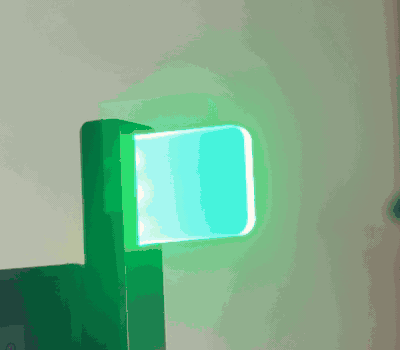
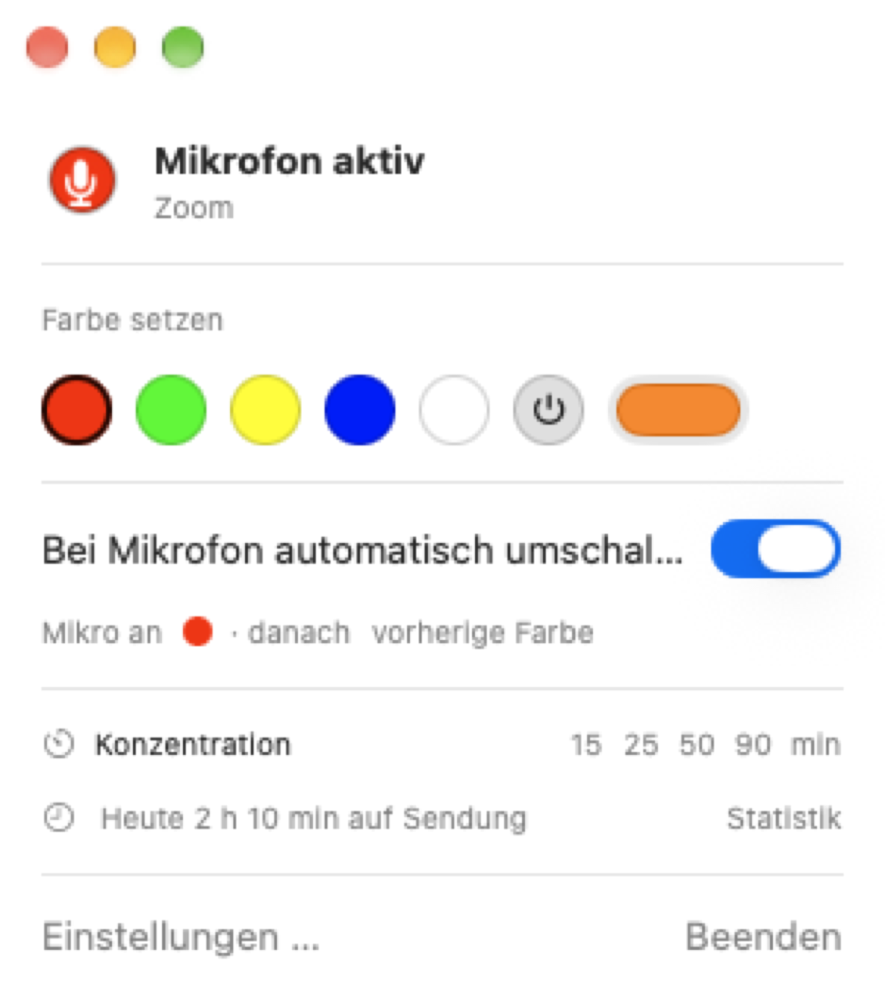
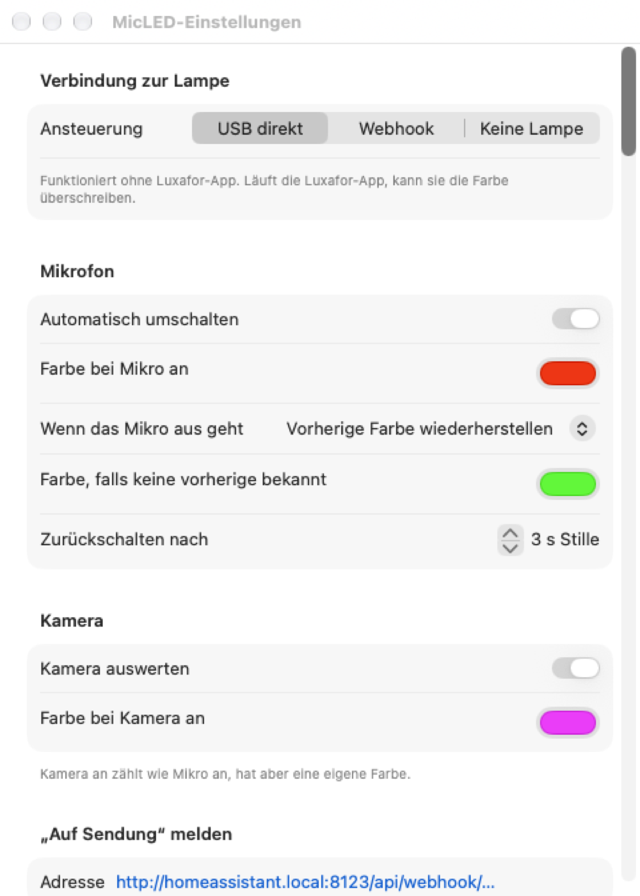
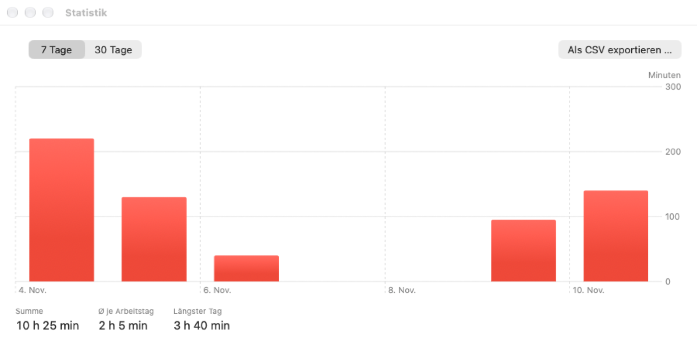
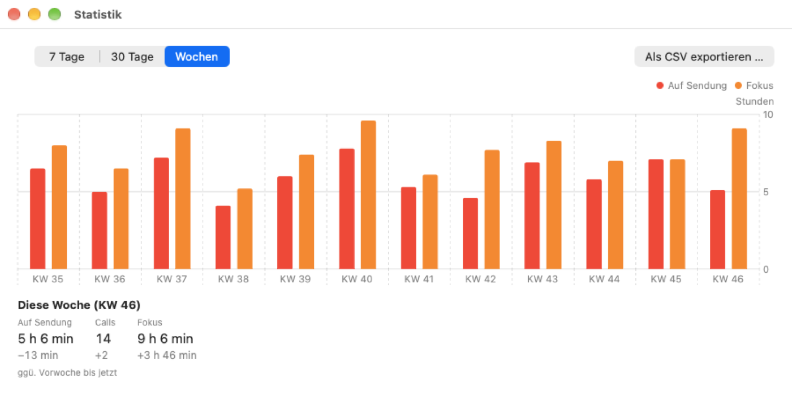
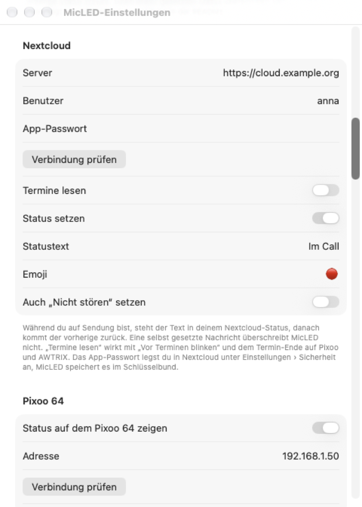
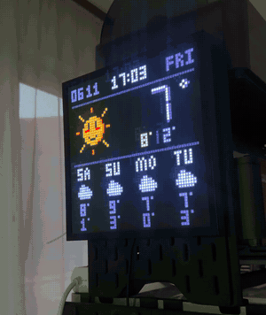
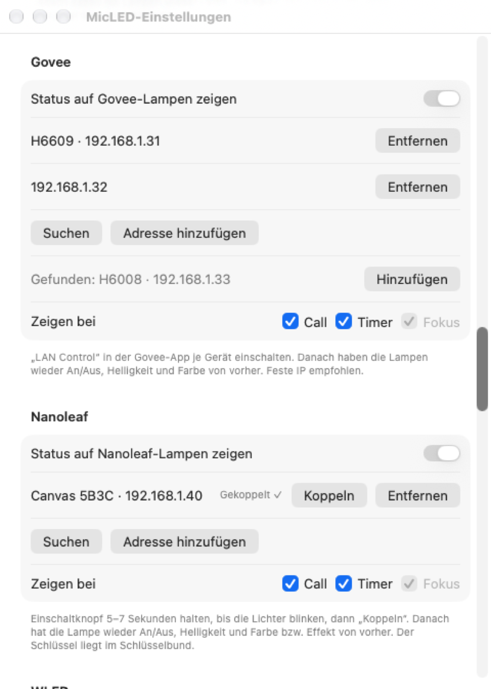
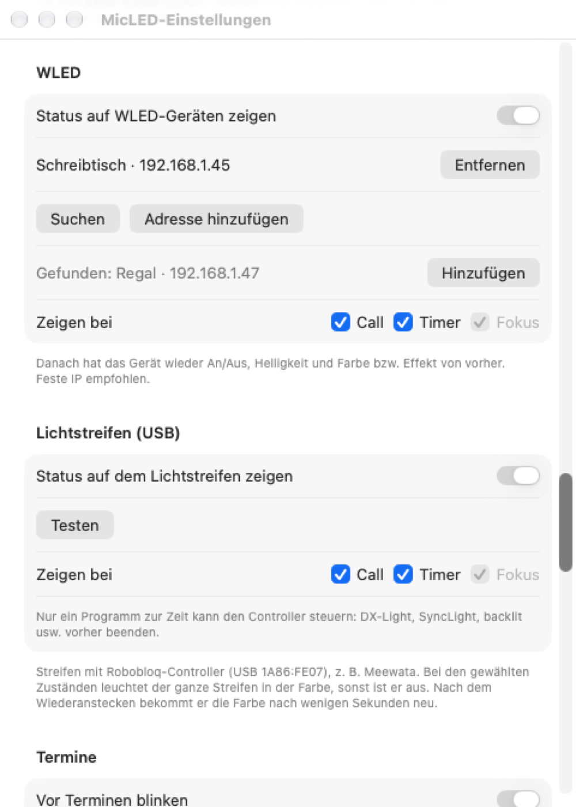
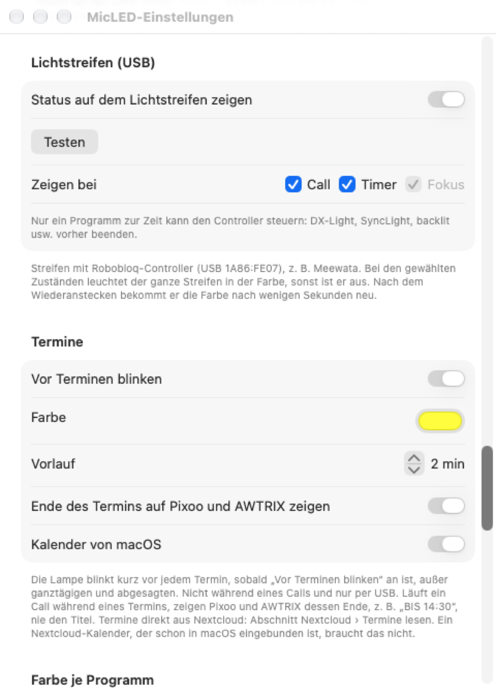

# MicLED

[](#voraussetzungen)
[](apps/MicLED)
[](crates/micled-core)
[](https://github.com/toolwerk/micled/actions/workflows/ci.yml)
[](LICENSE)

**Deine Luxafor-Lampe zeigt, wann du auf Sendung bist.** MicLED sitzt in der macOS-Menüleiste und schaltet die Lampe auf Rot, sobald ein Programm das Mikrofon oder die Kamera nutzt. Danach kommt die Farbe von vorher zurück.

Eine Luxafor brauchst du dafür nicht: MicLED zeigt den Status genauso mit Philips Hue, Govee, Nanoleaf, WLED, einem USB-Lichtstreifen oder auf einem Pixoo- bzw. AWTRIX-Display, einzeln oder zusammen.

<p align="center">
  
  &nbsp;&nbsp;
  <picture>
    <source media="(prefers-color-scheme: dark)" srcset="docs/images/menu-dark.png">
    
  </picture>
</p>

## Funktionen

- 🎙️ **Mikrofon und Kamera** werden erkannt, egal welches Programm: Zoom, Teams, Meet im Browser, FaceTime oder Plaud. Ton wird dabei nicht gelesen.
- 🎨 **Farben nach Wunsch**: eigene Farbe für Mikrofon, Kamera und einzelne Programme, danach zurück zur vorherigen Farbe.
- ⏱️ **Konzentrations-Timer** mit eigener Farbe; am Ende blinkt die Lampe.
- 🌙 **Fokus und Abend**: eigene Farbe, solange ein Fokus von macOS an ist, abends gedimmt.
- 📅 **Vorwarnung vor Terminen** aus den Kalendern von macOS oder direkt aus Nextcloud.
- 💬 **Slack-Status** „Im Call“, solange du auf Sendung bist.
- ☁️ **Nextcloud-Status** „Im Call“, auf Wunsch mit „Nicht stören“.
- 🖼️ **Pixoo 64**: „ON AIR“ (im Termin mit dessen Ende, z. B. „BIS 14:30“), Restzeit des Timers oder Fokus auf einem Divoom-Display im eigenen Netz, auch ganz ohne Lampe.
- 🕒 **AWTRIX-Uhr**: dieselbe Anzeige auf einer Ulanzi-Pixeluhr mit AWTRIX 3, etwa an der Bürotür.
- 💡 **Philips Hue**: eine Hue-Lampe oder ein ganzer Raum leuchtet in der Statusfarbe und kehrt danach zum Licht von vorher zurück.
- 🌈 **Govee, Nanoleaf und WLED**: Lampen und LED-Streifen im eigenen WLAN zeigen die Statusfarbe und bekommen danach ihr Licht bzw. ihren Effekt zurück, ohne Konto und ohne Cloud.
- 📺 **Lichtstreifen am Monitor**: ein USB-Streifen mit Robobloq-Controller (z. B. Meewata) leuchtet bei Call, Timer und Fokus in der Farbe.
- 🏠 **Home Assistant**: „Auf Sendung“ per Webhook, z. B. für ein Türschild.
- 📊 **Statistik**: Zeit auf Sendung je Tag, Wochen mit Fokuszeit im Vergleich zur Vorwoche, Export als CSV.
- ⌨️ **Steuerung von außen** über `micled://`-Adressen, Kurzbefehle und das Stream Deck.
- 🔌 **USB direkt** ohne Luxafor-App, wahlweise über den Luxafor-Webhook.

## Screenshots

<table>
  <tr>
    <td width="50%">
      <picture>
        <source media="(prefers-color-scheme: dark)" srcset="docs/images/settings-dark.png">
        
      </picture>
    </td>
    <td width="50%">
      <picture>
        <source media="(prefers-color-scheme: dark)" srcset="docs/images/stats-dark.png">
        
      </picture>
    </td>
  </tr>
  <tr>
    <td align="center">Einstellungen</td>
    <td align="center">Statistik</td>
  </tr>
</table>

<details>
<summary><b>Alle Funktionen im Detail</b></summary>

- Erkennt jedes Programm, das gerade vom Mikrofon liest (Zoom, Teams, Meet im Browser, Plaud, FaceTime …), über CoreAudio. Ton wird dabei nicht gelesen, eine Mikrofon-Freigabe ist nicht nötig.
- Zwei einstellbare Farben: „Mikro an“ (Standard Rot) und „Mikro aus“ (Standard Grün).
- Nach dem Mikrofon wahlweise zurück zur vorherigen Farbe oder immer auf die „Mikro aus“-Farbe.
- Schnellfarben und Farbwähler im Menü zum direkten Umschalten.
- Ansteuerung per USB direkt (ohne Luxafor-App) oder per Luxafor-Webhook.
- Programme lassen sich ignorieren, etwa ein Diktierwerkzeug, das das Mikrofon dauerhaft offen hält. Bekannte Audio-Dienste wie `arkaudiod` von Rogue Amoeba sind ab Werk eingetragen.
- Bei Ruhezustand, ausgeschaltetem Bildschirm und Sperre geht die Lampe aus und danach mit der vorherigen Farbe wieder an. Während eines Calls bleibt sie in der Mikrofarbe.
- Wartezeit vor dem Zurückschalten (Standard 3 Sekunden), damit kurze Pausen nicht flackern.
- Kamera-Erkennung über CoreMediaIO: Kamera an zählt wie Mikro an und hat eine eigene Farbe (Standard Magenta).
- Farbe je Programm, z. B. Orange für eine Aufnahme mit Plaud und Rot für Calls. Bei mehreren Programmen gilt der oberste Eintrag, die Kamerafarbe hat Vorrang.
- „Auf Sendung“ nach außen melden: Bei jedem Wechsel geht ein POST mit JSON an eine Adresse, etwa einen Home-Assistant-Webhook für ein Türschild.
- Slack-Status: Während du auf Sendung bist, steht z. B. 🔴 „Im Call“ in deinem Slack-Profil, danach kommt der vorherige Status zurück.
- Nextcloud-Status: Dasselbe im Benutzerstatus von Nextcloud, auf Wunsch mit „Nicht stören“; danach kommt der vorherige Status zurück.
- Vorwarnung vor Terminen: Die Lampe blinkt kurz vor jedem Termin (Vorlauf einstellbar, ab Werk aus). Termine kommen aus den Kalendern von macOS und auf Wunsch direkt aus Nextcloud.
- Konzentrations-Timer: Die Lampe zeigt 15 bis 90 Minuten lang eine eigene Farbe und blinkt am Ende. Start im Menü, per Rechtsklick auf das Symbol, über `micled://timer/25` oder Kurzbefehle.
- Fokus von macOS: Solange ein Fokus an ist, leuchtet die Lampe in der Fokusfarbe. Gibt macOS den Fokus nicht frei, meldet ihn eine Kurzbefehle-Automation („Fokus an MicLED melden“).
- Abends dimmen: In einer einstellbaren Zeitspanne (Standard 18–7 Uhr) leuchtet die Lampe gedimmt, die Farben rechnet MicLED herunter.
- Statistik: Im Menü steht, wie lange du heute auf Sendung warst. Das Fenster „Statistik“ zeigt die letzten 7 oder 30 Tage als Balken und exportiert alle Calls als CSV. Gespeichert wird ein Jahr.
- Wochen in der Statistik: Die Ansicht „Wochen“ zeigt für die letzten zwölf Kalenderwochen (Beginn Montag, Zeitzone des Macs) die Zeit auf Sendung und die Fokuszeit als Balken und die Zahl der Calls, darunter Zeit auf Sendung, Calls und Fokuszeit der laufenden Woche mit der Veränderung zur Vorwoche bis zum selben Wochentag und zur selben Uhrzeit. Als Fokuszeit zählt, solange der Konzentrations-Timer läuft oder ein Fokus von macOS an ist, Überschneidungen einmal und nur bei wachem, entsperrtem Mac mit eingeschaltetem Bildschirm. Den Fokus von macOS liest MicLED, sobald die Freigabe dafür besteht; um sie gebeten wird beim Einschalten von „Fokus von macOS anzeigen“ in den Einstellungen, danach zählt er auch bei ausgeschalteter Anzeige. Erfasst wird sie erst seit dem Update mit dieser Ansicht. Beim Export wählt „Inhalt“ zwischen allen Calls und den Summen je Woche (`week,start,live_seconds,calls,focus_seconds`).

  <picture>
    <source media="(prefers-color-scheme: dark)" srcset="docs/images/stats-week-dark.png">
    
  </picture>
- Steuerung von außen über `micled://`-Adressen und Aktionen in der Kurzbefehle-App, siehe unten.

</details>

## Steuerung von außen

Adressen, z. B. für Raycast, das Stream Deck („Website öffnen“) oder `open` im Terminal:

```text
micled://color/ff8800      Farbe setzen (auch micled://farbe/rot)
micled://off               Lampe aus
micled://auto/on           Automatik an (auch off, toggle)
micled://timer/25          Konzentrations-Timer für 25 Minuten (timer/off beendet ihn)
micled://focus/on          Fokus melden (auch off), z. B. aus einer Fokus-Automation
```

In der Kurzbefehle-App gibt es die Aktionen „Lampenfarbe setzen“, „Lampe ausschalten“, „Mikrofon-Automatik schalten“, „Konzentration starten“, „Konzentration beenden“ und „Fokus an MicLED melden“. Gibt macOS den Fokus nicht frei, meldet ihn eine Automation: Kurzbefehle › Automation › Fokus „Arbeiten“ an › „Fokus an MicLED melden“ (und eine zweite für aus).

## „Auf Sendung“ an Home Assistant

In den Einstellungen die Webhook-Adresse eintragen, z. B. `http://homeassistant.local:8123/api/webhook/micled`. MicLED sendet bei jedem Wechsel:

```json
{"on_air": true, "camera": false, "apps": ["us.zoom.xos"]}
```

In einer Home-Assistant-Automation mit Webhook-Auslöser steht der Wert als `{{ trigger.json.on_air }}` bereit.

### Beispiel: Lampe auf Sendung rot schalten

Die Automation merkt sich den Zustand der Lampe als Szene, schaltet sie rot und stellt sie am Ende des Calls wieder her. So lässt sich jede in Home Assistant eingebundene Lampe schalten, auch eine Hue-Lampe, die MicLED nicht direkt ansteuert. `light.tuerschild` und `webhook_id` an die eigene Lampe und die eigene Webhook-Adresse anpassen:

```yaml
alias: MicLED – Auf Sendung
mode: restart
triggers:
  - trigger: webhook
    webhook_id: micled
    allowed_methods: [POST]
    local_only: true
actions:
  - choose:
      - conditions: "{{ trigger.json.on_air }}"
        sequence:
          - condition: template
            value_template: "{{ state_attr('light.tuerschild', 'rgb_color') != (255, 0, 0) }}"
          - action: scene.create
            data:
              scene_id: vor_dem_call
              snapshot_entities: light.tuerschild
          - action: light.turn_on
            target:
              entity_id: light.tuerschild
            data:
              rgb_color: [255, 0, 0]
              brightness_pct: 100
    default:
      - condition: template
        value_template: "{{ states.scene.vor_dem_call is not none }}"
      - action: scene.turn_on
        target:
          entity_id: scene.vor_dem_call
```

Die Szene `vor_dem_call` entsteht zur Laufzeit und braucht keine eigene Konfiguration. MicLED sendet den Webhook auch dann erneut mit `on_air: true`, wenn während des Calls die Kamera an- oder ausgeht. Die Bedingung `rgb_color` verhindert, dass der Snapshot dann die rote Lampe festhält. Die Bedingung im `default`-Zweig überspringt das Zurückstellen, solange die Szene noch nicht existiert, etwa wenn der erste Webhook nach einem Neustart `on_air: false` ist. Startet Home Assistant während eines Calls neu, ist die Szene weg; die Lampe bleibt dann rot, bis du sie von Hand zurückstellst.

## Slack-Status

1. Unter <https://api.slack.com/apps> › „Create New App“ › „From scratch“ eine App im eigenen Workspace anlegen.
2. „OAuth & Permissions“ › „User Token Scopes“: `users.profile:read` und `users.profile:write` hinzufügen.
3. „Install to Workspace“ und den „User OAuth Token“ (`xoxp-…`) kopieren.
4. In MicLED unter Einstellungen › Slack einfügen und „Verbindung prüfen“ drücken.

MicLED setzt den Status nur, wenn gerade keiner gesetzt ist. Ändert sich der Status während des Calls, bleibt er danach stehen. Der eigene Status läuft nach vier Stunden von selbst ab, falls MicLED ihn nicht mehr zurücksetzen kann.

## Nextcloud-Status

Während du auf Sendung bist, steht in deinem Nextcloud-Benutzerstatus (Avatar oben rechts) z. B. 🔴 „Im Call“, danach ist die Nachricht wieder leer.

1. In Nextcloud unter Einstellungen › Sicherheit › „Neues App-Passwort erstellen“ ein App-Passwort anlegen.
2. In MicLED unter Einstellungen › Nextcloud Server (z. B. `https://cloud.example.org`), Benutzer und App-Passwort eintragen und „Verbindung prüfen“ drücken.
3. „Status setzen“ einschalten, Statustext und Emoji nach Wunsch anpassen.

<p align="center">
  <picture>
    <source media="(prefers-color-scheme: dark)" srcset="docs/images/settings-nextcloud-dark.png">
    
  </picture>
</p>

MicLED setzt die Nachricht nur, wenn gerade keine gesetzt ist. Eine eigene Nachricht („Homeoffice“) oder die von Talk während eines Anrufs bleibt stehen. Ändert sich die Nachricht während des Calls, bleibt sie danach stehen. Als Emoji passt nur ein einzelnes Zeichen, der Text darf höchstens 80 Zeichen lang sein; sonst lehnt Nextcloud ab, und im Menü steht „Nextcloud: Statustext oder Emoji ungültig“.

Mit **„Auch ‚Nicht stören‘ setzen“** (ab Werk aus) steht während des Calls zusätzlich „Nicht stören“. Das schaltet auch die Benachrichtigungen von Talk und der Nextcloud-App auf dem Handy stumm. Wer „Unsichtbar“ ist, bleibt es auch im Call. Danach kommt ein selbst gewählter Status „Abwesend“, „Unsichtbar“ oder „Nicht stören“ zurück, sonst „Online“. Hast du den Status während des Calls selbst geändert, bleibt er. Das gilt auch, wenn die Nachricht im Call abgelaufen oder ersetzt ist.

Die Nachricht läuft nach vier Stunden von selbst ab, „Nicht stören“ nicht. Stürzt MicLED im Call ab, räumt der nächste Start beides auf; der Status ist danach „Online“, weil MicLED den von vorher nicht mehr kennt. Ist die Nachricht bis dahin schon abgelaufen, bleibt „Nicht stören“ stehen.

## Welche Zustände ein Gerät zeigt

Pixoo 64, AWTRIX, Hue, Govee, Nanoleaf, WLED und der Lichtstreifen haben in ihrem Abschnitt der Einstellungen die Zeile „Zeigen bei“ mit den Häkchen „Call“, „Timer“ und „Fokus“. Ab Werk sind alle drei gesetzt, auch nach einem Update. So bleibt z. B. eine Hue-Lampe im Wohnzimmer bei Timer und Fokus, wie sie ist, und färbt sich nur bei einem Call.

Ein abgewählter Zustand gilt für dieses Gerät als frei. Läuft darunter ein Zustand, den es zeigen darf, zeigt es diesen: Ein Lichtstreifen ohne „Call“ bleibt während eines Calls in der Fokusfarbe, wenn „Fokus“ gesetzt ist. Sonst hat das Gerät seinen Zustand von vorher. „Fokus“ wirkt nur, wenn „Fokus von macOS anzeigen“ an ist, sonst ist das Häkchen ausgegraut. Die Luxafor-Lampe, Slack, Nextcloud und der Webhook folgen den Häkchen nicht.

## Pixoo 64

Ein Divoom Pixoo 64 im selben WLAN zeigt den Status zusätzlich zur Lampe oder statt ihr.

<p align="center">
  
</p>

Es zeigt:

- auf Sendung: Mikro- oder Kamerasymbol mit „ON AIR“ in der Mikro-, Kamera- oder Programmfarbe; läuft gerade ein Termin, steht darunter dessen Ende, z. B. „BIS 14:30“ (siehe [Ende des Termins](#ende-des-termins)),
- Konzentrations-Timer: die restlichen Minuten mit „MIN“, jede Minute neu,
- Fokus: „FOKUS“ in der Fokusfarbe.

Danach, beim Ausschalten und beim Beenden von MicLED läuft auf dem Display wieder, was vorher lief, z. B. die Uhr. Abends gedimmt werden auch die Farben auf dem Display.

1. In der Divoom-App die IP-Adresse des Pixoo nachsehen (Gerät › Einstellungen › WLAN) und ihm im Router eine **feste IP-Adresse** geben. Sonst findet MicLED das Display nach einem Neustart des Routers nicht mehr.
2. In MicLED unter Einstellungen › Pixoo 64 „Status auf dem Pixoo 64 zeigen“ einschalten, die Adresse eintragen und „Verbindung prüfen“ drücken.
3. macOS fragt beim ersten Mal nach dem Zugriff auf das **lokale Netzwerk**. Ohne diese Erlaubnis ist das Pixoo nicht erreichbar (ebenso ein Home Assistant im eigenen Netz). Nachträglich: Systemeinstellungen › Datenschutz & Sicherheit › Lokales Netzwerk › MicLED.

Ist das Display nicht erreichbar, steht ein Fehler im Menü und MicLED versucht es alle 30 Sekunden erneut. Die Lampe schaltet trotzdem sofort.

## AWTRIX-Uhr

Eine Ulanzi-Pixeluhr (TC001) mit der Firmware [AWTRIX 3](https://blueforcer.github.io/awtrix3/) im selben WLAN zeigt den Status zusätzlich zur Lampe oder statt ihr. Die Firmware muss schon auf der Uhr sein; MicLED spricht über deren lokale HTTP-API, ein MQTT-Broker ist nicht nötig.

Der Text steht über die ganze Anzeige und bleibt bis zum Ende stehen, mit Endzeit läuft er durch:

- auf Sendung: „ON AIR“ in der Mikro-, Kamera- oder Programmfarbe; läuft gerade ein Termin, läuft „ON AIR BIS 14:30“ als Lauftext durch (siehe [Ende des Termins](#ende-des-termins)),
- Konzentrations-Timer: die restlichen Minuten, z. B. „25 MIN“, jede Minute neu,
- Fokus: „FOKUS“ in der Fokusfarbe.

Sonst läuft die normale Anzeige der Uhr, auch bei Ruhezustand und Bildschirmsperre, außer du bist gerade in einem Call. Abends gedimmt werden auch die Farben auf der Uhr.

1. Die IP-Adresse der Uhr in der Geräteliste des Routers nachsehen und ihr dort eine **feste IP-Adresse** geben. Sonst findet MicLED die Uhr nach einem Neustart des Routers nicht mehr.
2. In MicLED unter Einstellungen › AWTRIX „Status auf der AWTRIX-Uhr zeigen“ einschalten, die Adresse eintragen und „Verbindung prüfen“ drücken. Neben dem Knopf steht dann „AWTRIX erreichbar“.
3. Wie beim Pixoo braucht MicLED den Zugriff auf das **lokale Netzwerk**.

Gut zu wissen:

- Die mittlere Taste der Uhr entfernt die Anzeige auch während eines Calls. MicLED bemerkt das nicht, sie kommt beim nächsten Wechsel zurück.
- Beim Start, beim Einschalten in den Einstellungen und nach einer neuen Adresse räumt MicLED einmal die oberste Benachrichtigung der Uhr ab, damit nach einem Absturz kein altes „ON AIR“ stehen bleibt. Eine gerade sichtbare Benachrichtigung eines anderen Dienstes verschwindet dabei ebenfalls.
- Benachrichtigungen anderer Dienste, etwa aus Home Assistant, die während der Anzeige eintreffen, warten bis zum Ende. Steht eine schon an erster Stelle, wenn die Anzeige beginnt, wird sie ersetzt und kommt nicht zurück. Sendet ein Dienst mit sofortigem Ersetzen, verdrängt er die Anzeige bis zum nächsten Wechsel.
- Am Ende einer Anzeige entfernt MicLED immer die oberste Benachrichtigung. Hat ein anderer Dienst die Anzeige verdrängt oder ist seine Meldung nach der mittleren Taste nachgerückt, verschwindet sie dabei.

Ist die Uhr nicht erreichbar, steht ein Fehler im Menü und MicLED versucht es alle 30 Sekunden erneut. Die Lampe schaltet trotzdem sofort.

## Philips Hue

Eine Hue-Lampe, etwa vor der Tür, oder alle Lampen eines Raums zeigen den Status zusätzlich zur Lampe oder statt ihr. MicLED spricht dafür direkt mit der Hue Bridge im eigenen Netz, ohne Cloud und ohne Hue-Konto.

Die Lampe leuchtet auf Sendung in der Mikro-, Kamera- oder Programmfarbe, beim Konzentrations-Timer und bei Fokus in deren Farbe, abends entsprechend gedimmt. Danach, beim Ausschalten und beim Beenden von MicLED hat jede Lampe wieder An/Aus, Farbe und Helligkeit von vorher. Eine vorher ausgeschaltete Lampe leuchtet dabei kurz in ihrer alten Farbe auf, bevor sie ausgeht; so hat sie beim nächsten Einschalten nicht die Call-Farbe. Was du während eines Calls in der Hue-App änderst, überschreibt MicLED danach mit dem Zustand von vor dem Call.

1. In der Hue-App die IP-Adresse der Bridge nachsehen (Einstellungen › Bridges › Bridge › IP-Adresse) und ihr im Router eine **feste IP-Adresse** geben.
2. In MicLED unter Einstellungen › Philips Hue „Status auf einer Hue-Lampe zeigen“ einschalten und die Adresse eintragen.
3. Den runden Knopf auf der Bridge drücken und innerhalb von 30 Sekunden „Koppeln“ wählen. Es erscheint „Gekoppelt ✓“. Der App-Schlüssel liegt im Schlüsselbund.
4. Unter „Lampe“ einen Raum („Raum: …“) oder eine einzelne Lampe wählen. Bei einem Raum werden alle Lampen darin geschaltet; das Zurückstellen dauert bei vielen Lampen einige Sekunden.

Beim Koppeln merkt sich MicLED das Zertifikat der Bridge und spricht danach nur mit genau dieser. Wird die Bridge ausgetauscht oder zurückgesetzt, steht im Menü „Zertifikat der Bridge hat sich geändert, bitte neu koppeln“; dann Schritt 3 wiederholen. Eine neue Adresse löscht die Kopplung ebenfalls.

Ist die Bridge nicht erreichbar, steht ein Fehler im Menü und MicLED versucht es alle 30 Sekunden erneut. Lampe und Pixoo schalten trotzdem sofort. Wie beim Pixoo braucht MicLED den Zugriff auf das **lokale Netzwerk**.

Hue-Lampen, die du lieber über Home Assistant steuerst (oder die du dort ohnehin eingebunden hast), schaltet eine Automation per Webhook, ohne dass MicLED die Bridge kennt: [Beispiel unter „Auf Sendung“ an Home Assistant](#beispiel-lampe-auf-sendung-rot-schalten).

## Govee

<p align="center">
  <picture>
    <source media="(prefers-color-scheme: dark)" srcset="docs/images/settings-network-dark.png">
    
  </picture>
</p>

Govee-Lampen mit Steuerung im eigenen Netz, etwa das Monitor-Backlight Gaming Light Strip G1 (H6609), zeigen den Status ohne Govee-Konto und ohne Cloud. Welche Modelle das können, steht in der [Liste von Home Assistant](https://www.home-assistant.io/integrations/govee_light_local/). Mehrere Lampen sind möglich.

Auf Sendung, beim Konzentrations-Timer und bei Fokus leuchten die Lampen in deren Farbe, abends entsprechend gedimmt. Danach haben sie wieder An/Aus, Helligkeit und Farbe bzw. Weißton von vorher. Szenen und Bildschirm-Sync (DreamView) meldet eine Govee-Lampe im eigenen Netz nicht; lief so etwas, endet es mit dem Call, und die Lampe bekommt danach eine feste Farbe (die zuletzt gemeldete, sonst neutrales Weiß).

1. In der Govee-App je Gerät „LAN Control“ einschalten (Gerät › Einstellungen) und der Lampe im Router eine **feste IP-Adresse** geben.
2. In MicLED unter Einstellungen › Govee „Status auf Govee-Lampen zeigen“ einschalten und „Suchen“ drücken. Gefundene Lampen mit „Hinzufügen“ übernehmen. Findet die Suche nichts, etwa in einem Mesh- oder Gastnetz, trägt „Adresse hinzufügen“ die IP von Hand ein.
3. Wie beim Pixoo braucht MicLED den Zugriff auf das **lokale Netzwerk**; macOS fragt bei der ersten Suche danach.

Govee-Lampen antworten immer an Port 4002 des Macs. Läuft auf demselben Mac schon eine andere Govee-Steuerung, etwa Home Assistant, steht im Menü „Port 4002 belegt, läuft hier eine andere Govee-Steuerung?“, und MicLED findet und schaltet die Lampen nicht.

## Nanoleaf

Light Panels, Canvas, Shapes, Elements, Lines und Skylight zeigen den Status über ihre Schnittstelle im eigenen Netz, ohne Konto und ohne Cloud. Mehrere Geräte sind möglich.

Auf Sendung, beim Konzentrations-Timer und bei Fokus leuchten sie in deren Farbe, abends entsprechend gedimmt. Danach haben sie wieder An/Aus, Helligkeit und Farbe von vorher; lief ein gespeicherter Effekt, läuft er danach wieder.

1. In MicLED unter Einstellungen › Nanoleaf „Status auf Nanoleaf-Lampen zeigen“ einschalten und „Suchen“ drücken. Gefundene Geräte mit „Hinzufügen“ übernehmen oder mit „Adresse hinzufügen“ die IP von Hand eintragen (feste IP im Router empfohlen).
2. Am Gerät den Einschaltknopf 5–7 Sekunden halten, bis die Lichter blinken, und innerhalb von 30 Sekunden „Koppeln“ drücken. Es erscheint „Gekoppelt ✓“. Der Schlüssel liegt im Schlüsselbund unter „net.staude.micled.nanoleaf“.
3. Wie beim Pixoo braucht MicLED den Zugriff auf das **lokale Netzwerk**.

Eine neue Adresse oder „Entfernen“ löscht die Kopplung. Steht im Menü „Schlüssel ungültig, neu koppeln“, Schritt 2 wiederholen.

### Nicht unterstützt

- **Nanoleaf Essentials** (Glühbirnen und Lichtstreifen mit Matter oder HomeKit über Thread) haben keine Schnittstelle im eigenen Netz.
- **Govee ohne Steuerung im eigenen Netz**, etwa die AI Sync Box H6603/H6604, und Govee-Geräte, die nur Bluetooth haben.

Für diese Geräte: in Home Assistant einbinden und dort per Automation mit dem Webhook aus [„Auf Sendung“ an Home Assistant](#auf-sendung-an-home-assistant) schalten.

## WLED

<p align="center">
  <picture>
    <source media="(prefers-color-scheme: dark)" srcset="docs/images/settings-wled-dark.png">
    
  </picture>
</p>

LED-Streifen und -Lampen mit der freien Firmware [WLED](https://kno.wled.ge/) zeigen den Status über deren Schnittstelle im eigenen Netz, ohne Konto, ohne Koppeln und ohne Cloud. Mehrere Geräte sind möglich.

Auf Sendung, beim Konzentrations-Timer und bei Fokus leuchten alle Segmente einfarbig in deren Farbe, abends entsprechend gedimmt. Danach haben sie wieder An/Aus, Helligkeit und je Segment Farbe und Effekt von vorher.

- Lief ein **Preset**, stellt MicLED dessen Aussehen zurück, lädt das Preset aber nicht neu. So bleibt etwa eine danach gedimmte Helligkeit erhalten. In der WLED-App ist das Preset danach nicht mehr markiert, das Licht sieht aber gleich aus.
- Lief eine **Playlist**, startet sie danach von vorn.
- Empfängt das Gerät gerade **Live-Daten** einer anderen Steuerung, etwa Bildschirm-Sync über Hyperion, hat MicLED für die Dauer des Calls Vorrang und gibt danach wieder frei.
- Ein laufendes **Nachtlicht** (auch Sonnenaufgang) beendet der Call, danach startet es nicht neu.
- Per **WLED-Sync** gekoppelte Geräte bekommen die Statusfarbe nicht mit; sollen sie mitleuchten, trag sie ebenfalls ein. Empfängt ein eingetragenes Gerät selbst Sync von einem anderen, kann dessen nächste Änderung die Statusfarbe überschreiben.

1. Dem Gerät im Router eine **feste IP-Adresse** geben.
2. In MicLED unter Einstellungen › WLED „Status auf WLED-Geräten zeigen“ einschalten und „Suchen“ drücken. Gefundene Geräte mit „Hinzufügen“ übernehmen oder mit „Adresse hinzufügen“ die IP von Hand eintragen, bei einem anderen Port als 80 mit Port (`192.168.1.45:8080`).
3. Wie beim Pixoo braucht MicLED den Zugriff auf das **lokale Netzwerk**.

Ist eine Govee- oder Nanoleaf-Lampe oder ein WLED-Gerät nicht erreichbar, steht ein Fehler mit der Adresse im Menü und MicLED versucht es alle 30 Sekunden erneut. Lampe und die anderen Geräte schalten trotzdem sofort. Einzige Ausnahme: Govee-Lampen teilen sich Port 4002, deshalb wartet eine Govee-Lampe bis zu einer Sekunde je nicht erreichbarer Govee-Lampe.

## Lichtstreifen (USB)

Viele Lichtstreifen hinter dem Monitor mit Bildschirm-Sync nutzen denselben Controller von Robobloq, gesteuert sonst mit der App DX-Light bzw. DX-Lighting. MicLED schaltet ihn direkt per USB, ohne Treiber, zusätzlich zur Luxafor.

<p align="center">
  <picture>
    <source media="(prefers-color-scheme: dark)" srcset="docs/images/settings-strip-dark.png">
    
  </picture>
</p>

Bekannte Geräte: Meewata, Robobloq/SyncLight, DS leddess, Eastfine, DX LIGHT (Vortex Gears), LEDstrips.dk „PC Sync“ und namenlose Streifen von AliExpress. Maßgeblich ist die **USB-ID `1A86:FE07`**, nicht der Produktname: Händler liefern unter gleichem Namen teils andere Controller. Den Controller `1A86:FE0C` und andere unterstützt MicLED nicht. Die USB-ID steht im Systembericht unter USB („ROBOBLOQ USBHID“, Hersteller-ID `0x1a86`, Produkt-ID `0xfe07`).

1. Streifen per USB an den Mac stecken.
2. In MicLED unter Einstellungen › Lichtstreifen (USB) „Status auf dem Lichtstreifen zeigen“ einschalten.
3. „Testen“ drücken. Der Streifen leuchtet etwa zwei Sekunden rot und zeigt danach wieder, was MicLED gerade zeigt (aus oder die Farbe von Call, Timer oder Fokus). Darunter erscheint z. B. „Gefunden: 78 LEDs, Firmware 1.9.4 ✓“. Findet MicLED den Streifen nicht oder antwortet er nicht, steht dort ein Fehler, und er bleibt unverändert.

Bei Call, Timer und Fokus leuchtet der ganze Streifen in deren Farbe, abends gedimmt; welche davon er zeigt, legen die Häkchen fest ([Welche Zustände ein Gerät zeigt](#welche-zustände-ein-gerät-zeigt)). Bist du frei, ist er aus; seinen eingebauten Effekt holt MicLED nicht zurück. Nach einem Stromverlust läuft wieder der eingebaute Effekt, bis MicLED den Streifen ausschaltet. MicLED sieht alle fünf Sekunden nach dem Streifen; nach dem Wiederanstecken bekommt er die aktuelle Farbe neu. Fehlt er oder hat er eine andere USB-ID, steht ein Fehler im Menü. Wie DX-Light begrenzt MicLED die Summe von Rot, Grün und Blau, damit der USB-Anschluss nicht überlastet; Weiß und Mischfarben wirken deshalb etwas dunkler.

**Nur ein Programm zur Zeit kann mit dem Controller sprechen.** Wer DX-Light, SyncLight, backlit oder ein anderes Programm für den Streifen laufen lässt, beendet es, damit MicLED ihn steuern kann.

Die Seriennummer ist bei allen Streifen gleich. Hängen zwei Streifen am Mac, zeigen beide dieselbe Farbe.

## Ende des Termins

Läuft ein Call während eines Termins, zeigen Pixoo 64 und AWTRIX-Uhr zusätzlich, bis wann er voraussichtlich dauert, z. B. „BIS 14:30“ in Ortszeit. Der Titel des Termins erscheint nie, wer vor der Tür steht, sieht nur die Uhrzeit. Lampen, Hue, Govee, Nanoleaf und Lichtstreifen zeigen keine Endzeit.

- Es zählt ein Termin, der schon begonnen hat und noch nicht zu Ende ist. Ganztägige, abgelehnte und abgesagte Termine zählen nicht, ebenso Einträge über 12 Stunden.
- Laufen mehrere Termine gleichzeitig, gilt das Ende des zuletzt begonnenen.
- Dauert der Call länger, verschwindet die Zeit mit dem Terminende, „ON AIR“ bleibt.
- Abschalten unter Einstellungen › Termine › „Ende des Termins auf Pixoo und AWTRIX zeigen“ (ab Werk an).

MicLED liest die Kalender dafür auch, wenn „Vor Terminen blinken“ aus ist, sobald Pixoo oder AWTRIX eingeschaltet sind. macOS fragt dann einmal nach dem Kalenderzugriff. Die Quellen sind dieselben wie bei der Vorwarnung (siehe [Termine aus Nextcloud](#termine-aus-nextcloud)).

## Termine aus Nextcloud

Für die Vorwarnung und das Ende des Termins gibt es zwei Wege:

1. **Über macOS** (empfohlen, wenn du den Kalender ohnehin auf dem Mac nutzt): Systemeinstellungen › Internet-Accounts › Account hinzufügen › Andere › CalDAV-Account, Accounttyp „Manuell“, Server `https://<deine-nextcloud>/remote.php/dav`. MicLED liest alle Kalender, die in der Kalender-App erscheinen.
2. **Direkt in MicLED**: Einstellungen › Nextcloud › Server (z. B. `https://cloud.example.org`), Benutzer und ein App-Passwort eintragen und „Termine lesen“ einschalten; das wirkt mit „Vor Terminen blinken“ und mit dem Termin-Ende auf Pixoo und AWTRIX. Das App-Passwort legst du in Nextcloud unter Einstellungen › Sicherheit › „Neues App-Passwort erstellen“ an. MicLED speichert es im Schlüsselbund und fragt alle zwei Minuten die laufenden Termine und die der nächsten Stunde ab, Serientermine eingeschlossen. „Verbindung prüfen“ zeigt, wie viele Kalender gefunden wurden.

Beide Wege lassen sich kombinieren, ein Termin in beiden Quellen blinkt nur einmal. Wer nur „Termine lesen“ in Nextcloud nutzt, schaltet „Kalender von macOS“ aus; dann fragt MicLED auch nicht nach dem Kalenderzugriff. Beim direkten Abruf wird nicht ausgewertet, ob du einen Termin abgelehnt hast.

## Woher kennt MicLED die vorherige Farbe?

Die Lampe kann ihre aktuelle Farbe nicht melden, weder per USB noch per Webhook. MicLED merkt sich deshalb die Farbe, die zuletzt gesetzt wurde:

- über das eigene Menü,
- über das Stream-Deck-Plugin `net.staude.luxafor` ab Version 1.1. Es schreibt jede feste Farbe in die gemeinsame Datei `~/Library/Application Support/net.staude.luxafor/state.json`.

Farbwechsel aus der Luxafor-App bekommt MicLED nicht mit.

## Voraussetzungen

- macOS 14 oder neuer
- Xcode (wird nur zum Bauen gebraucht, nicht geöffnet), `xcodegen`, Rust über `rustup`
- Luxafor Flag, Orb oder Bluetooth (USB-Kennung 04d8:f372) oder eines der anderen Geräte: Philips Hue, Govee, Nanoleaf, WLED, Lichtstreifen mit Robobloq-Controller, Pixoo 64 oder AWTRIX-Uhr. Ohne Luxafor unter Einstellungen › Verbindung zur Lampe „Keine Lampe“ wählen (siehe [Einrichten](#einrichten)); das reicht auch, wenn MicLED nur den Slack-Status setzen oder den Webhook auslösen soll.

## Einrichten

```bash
./setup.sh            # Werkzeuge prüfen, Tests, Rust-Kern bauen, Xcode-Projekt erzeugen
open apps/MicLED/MicLED.xcodeproj
```

Vor dem ersten signierten Build die Team-ID in `apps/MicLED/project.yml` unter `DEVELOPMENT_TEAM` eintragen.

Unter Einstellungen › Verbindung zur Lampe wählst du „USB direkt“, „Webhook“ (über die Luxafor-App) oder **„Keine Lampe“**. Ohne Lampe zeigt MicLED den Status nur auf dem [Pixoo 64](#pixoo-64), der [AWTRIX-Uhr](#awtrix-uhr), in Slack, in Nextcloud und am Webhook, und im Menü steht kein Lampenfehler.

## Kommandozeile

Der Rust-Kern lässt sich ohne Xcode testen:

```bash
cargo run -p micled-cli -- mic                 # wer nutzt gerade das Mikrofon, läuft eine Kamera?
cargo run -p micled-cli -- set ff8800          # Farbe setzen (auch: rot, gruen, aus)
cargo run -p micled-cli -- off
cargo run -p micled-cli -- watch               # Automatik, Strg-C beendet
cargo run -p micled-cli -- watch --on ff0000 --off 00ff00 --fixed --delay 5
cargo run -p micled-cli -- watch --camera ff00ff --on-air-url http://…   # oder --no-camera
cargo run -p micled-cli -- --webhook <ID> set gruen
MICLED_NEXTCLOUD_PASSWORD=<app-passwort> cargo run -p micled-cli -- nextcloud https://cloud.example.org <benutzer>
cargo run -p micled-cli -- pixoo 192.168.1.50  # Pixoo prüfen: 5 s „ON AIR“, dann zurück zum vorherigen Kanal
cargo run -p micled-cli -- awtrix 192.168.1.60 # AWTRIX-Uhr prüfen: 5 s „ON AIR“, dann wieder die normale Anzeige
cargo run -p micled-cli -- hue pair 192.168.1.20  # nach dem Druck auf den Bridge-Knopf: Schlüssel und Fingerabdruck
MICLED_HUE_KEY=<schlüssel> MICLED_HUE_FINGERPRINT=<fingerabdruck> \
  cargo run -p micled-cli -- hue test 192.168.1.20 <lampen-id> [--room]   # 5 s Rot, dann zurück
cargo run -p micled-cli -- govee scan          # Govee-Lampen mit „LAN Control“ suchen
cargo run -p micled-cli -- govee test 192.168.1.31   # 5 s Rot, dann zurück
cargo run -p micled-cli -- nanoleaf scan       # Nanoleaf per Bonjour suchen
cargo run -p micled-cli -- nanoleaf pair 192.168.1.40   # nach 5–7 s Einschaltknopf: Schlüssel
MICLED_NANOLEAF_KEY=<schlüssel> cargo run -p micled-cli -- nanoleaf test 192.168.1.40   # 5 s Rot, dann zurück
cargo run -p micled-cli -- wled scan           # WLED per Bonjour suchen
cargo run -p micled-cli -- wled test 192.168.1.45    # 5 s Rot, dann zurück
cargo run -p micled-cli -- strip info          # Lichtstreifen per USB: LEDs, Monitorgröße, Firmware
cargo run -p micled-cli -- strip test          # 5 s Rot, dann aus
```

## Aufbau

```
crates/micled-core   Lampe (USB/Webhook), Mikrofon und Kamera, Logik, Statusdatei, Nextcloud-Kalender und -Status, Slack-Status, Bilder für den Pixoo 64, AWTRIX-Uhr, Hue Bridge, Govee, Nanoleaf, WLED, Lichtstreifen (USB)
crates/micled-cli    Kommandozeile `micled`
crates/micled-ffi    UniFFI-Schicht für Swift
apps/MicLED          SwiftUI-Menüleisten-App, project.yml für xcodegen
scripts/             build-rust.sh, bump-build.sh, release.sh, appcast.sh, screenshots.sh
docs/images/         Screenshots und Videos von Lampe und Pixoo (lamp.gif, pixoo.gif) für diese README
```

Das Xcode-Target `RustCore` (Abhängigkeit der App) ruft `scripts/build-rust.sh` auf. Das Skript baut eine universelle statische Bibliothek, erzeugt die Swift-Bindings und legt Bibliothek und Header unter `build/universal` und `build/include` ab. Generierte Dateien werden nicht eingecheckt.

## Screenshots aktualisieren

```bash
scripts/screenshots.sh
```

Das Skript baut die Debug-App, startet sie mit Beispieldaten (Schalter `--screenshots`, nur in Debug-Builds) und nimmt Menü, Einstellungen (oben, bei Nextcloud, bei Govee/Nanoleaf, bei WLED und beim Lichtstreifen) und Statistik (Tage und Wochen) in Hell und Dunkel nach `docs/images/` auf. Lampe, Slack und Nextcloud bleiben dabei unberührt. Das Terminal braucht einmalig das Recht „Bildschirmaufnahme“ (Systemeinstellungen › Datenschutz & Sicherheit).

## Updates

MicLED sucht einmal am Tag mit [Sparkle](https://sparkle-project.org) nach einer neuen Version und fragt vor der Installation nach. Von Hand geht das im Menü und im Kontextmenü mit „Nach Updates suchen …“, abschalten lässt sich die Suche in den Einstellungen unter „Updates“. Damit Sparkle die App ersetzen kann, muss sie in „Programme“ liegen und nicht in „Downloads“. Entwickler-Builds suchen nicht nach Updates.

## Release

Einmalig: das Notarisierungsprofil und der Sparkle-Schlüssel. Der private Schlüssel bleibt im Anmelde-Schlüsselbund (Eintrag `micled`) und kommt nie ins Repo.

```bash
xcrun notarytool store-credentials micled --apple-id <Apple-ID> --team-id <TEAM> --password <app-spezifisch>

(cd apps/MicLED && xcodegen generate)
xcodebuild -resolvePackageDependencies -project apps/MicLED/MicLED.xcodeproj -clonedSourcePackagesDirPath build/spm
build/spm/artifacts/sparkle/Sparkle/bin/generate_keys --account micled
build/spm/artifacts/sparkle/Sparkle/bin/generate_keys --account micled -x <datei>   # Sicherung für den Passwortmanager, danach löschen
```

Den ausgegebenen öffentlichen Schlüssel in `apps/MicLED/Resources/Info.plist` bei `SUPublicEDKey` eintragen und committen. Den Schlüssel nie ersetzen: Installierte Apps nehmen nur Updates an, die mit ihm signiert sind.

Für jedes Release (bei einer neuen Version vorher `MARKETING_VERSION` in `apps/MicLED/project.yml` hochsetzen):

```bash
scripts/bump-build.sh
git commit -am "chore(release): build <N>"
scripts/release.sh
```

`release.sh` prüft zuerst Zertifikat, Notarisierungsprofil, Team-ID, sauberen Git-Stand, den Sparkle-Schlüssel und ob die Build-Nummer über der veröffentlichten liegt, denn Sparkle bietet nur eine höhere an. Danach folgen Archiv, Export mit Developer ID, Notarisierung, Stapeln und Prüfung mit `codesign`, `spctl` und `stapler`. Zum Schluss signiert `scripts/appcast.sh` das ZIP und schreibt `dist/appcast.xml`.

Beide Dateien gehören an den Release `v<Version>`, den GitHub als „Latest“ führt. Die App liest den Appcast unter `https://github.com/toolwerk/micled/releases/latest/download/appcast.xml`. Das Skript gibt am Ende die passenden Befehle aus: erst das ZIP, dann der Appcast, zuletzt wird der Release „Latest“. Die Reihenfolge einhalten, damit der Appcast nie auf ein fehlendes ZIP zeigt und die feste Adresse immer einen Appcast liefert.

## Lizenz

MIT. Die App enthält [Sparkle](https://github.com/sparkle-project/Sparkle), ebenfalls MIT.
